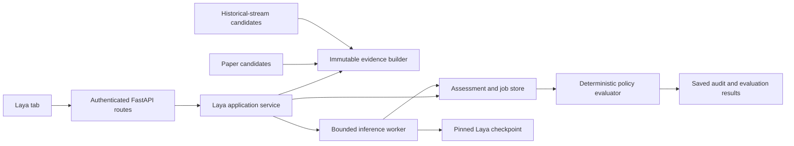

# Laya integration plan

Status: proposal; no Laya runtime, model, trading rule, or UI change implemented by this document.

Prepared: 2026-10-13. Target: a seventh web navigation tab, **Laya**, after Indicators.

## 1. Recommendation and intended outcome

Add Laya as a local, optional assessment service with its own research workspace. Use it to classify supplied financial text and assess the textual evidence surrounding an existing trading candidate. Start with saved, inspectable assessments; validate those assessments in causal historical experiments; then introduce paper shadow mode and, only after validation, an explicit paper entry filter.

The intended navigation is:

`Explorer | Backtest | Paper | Replay | Patterns | Indicators | Laya`

Laya should answer bounded questions such as “Does this announcement describe dilution?” or “Does the supplied evidence support this candidate's direction?” Existing code must continue to calculate indicators, detect patterns, calculate reward/risk, size positions, enforce market restrictions, and manage exits. Laya's answer is additional evidence, not authority to change those rules.

The first useful delivery is a working Laya tab with two inputs—an existing symbol/candidate snapshot and pasted source text—plus saved results, provenance, and an honest unavailable state. It must work without purchasing a news feed. Automatic news ingestion, fine-tuning, and active entry filtering are subsequent milestones with explicit acceptance criteria.

### Success means

- An operator can select US or PH, inspect exactly what Laya received, run an assessment, reload the page, and recover the same saved result.
- Every assessment identifies its market, symbol, evidence cutoff, source data, question schema, package/model revision, and calibration status.
- Historical experiments compare a frozen baseline with the same strategy plus a frozen Laya policy, using only information available at the decision time.
- Turning Laya off preserves baseline trading behavior and removes model loading from ordinary startup.
- A paper assessment can be traced from a candidate through a decision to its trade/export without losing the original pattern provenance.
- Evaluation may conclude that a use case has no trading benefit. The tab remains useful for research without enabling that filter.

## 2. What upstream actually supplies

Laya is a text decision model exposing typed `choice`, `score`, and `noul` questions. The Python quickstart uses `Router.predict(state, questions)` and returns an `answers` mapping plus routing information. It does not generate a prose rationale, fetch market data, consume chart PNGs as a vision model, or provide a validated stock-return forecasting API. Upstream latency numbers are hardware-specific measurements, not latency promises for this deployment. [Upstream overview](https://github.com/NandhaKishorM/laya)

| Upstream fact inspected | Implication here |
| --- | --- |
| English, multilingual, and typed-decisions checkpoints are available. | Benchmark a pinned English model for English snapshots and a pinned multilingual model for relevant non-English text. |
| Router supports explicit models and revisions; loading is lazy and resident models are capped. | Freeze routing/model policy per experiment; start with one resident checkpoint. |
| Typed-decisions targets specific non-trading workflows. | Do not assume its name makes it a better trading model. |
| Package metadata inspected declares version 0.4.6 and Python >=3.10. | Treat 0.4.6 as an inspected candidate, not a verified installed release or final compatibility lock. |
| Core dependencies include PyTorch, Transformers, Hugging Face Hub, Safetensors, and NumPy. | Keep installation optional and verify the full resolved stack in a separate environment. |
| The optional `mcp` extra requires `mcp>=2.2.0`. | It conflicts with this repository's `mcp>=1.28.0,<2`; do not install that extra here. |

Sources: [Router implementation](https://github.com/NandhaKishorM/laya/blob/main/laya/router.py), [package metadata](https://github.com/NandhaKishorM/laya/blob/main/pyproject.toml).

The English checkpoint's documented context is 512 tokens; multilingual defaults to 1,024 and documents support for larger inputs. Instructions and options consume space too. Keep the first templates compact and reject incomplete evidence rather than silently accepting truncation. [Overview](https://github.com/NandhaKishorM/laya), [sequence construction](https://github.com/NandhaKishorM/laya/blob/main/laya/common.py)

There are two importantly different confidence fields: `answer_confidence` represents the maximum answer probability, while `confidence` is entropy-derived. Upstream itself warns that shipped probabilities need held-out calibration. Neither is a probability that a trade will make money. For application thresholds, require valid `answer_confidence`; do not silently substitute the entropy field. [Confidence implementation](https://github.com/NandhaKishorM/laya/blob/main/laya/confidence.py)

`noul` is a yes/no probability, not a Boolean verdict. A high-confidence “no” can have a low probability of “yes.” Likewise, a `score` answer refers to an ordered rubric, not expected return. Preserve the distribution, rubric order, and raw typed result before normalizing anything for display. [Answer implementation](https://github.com/NandhaKishorM/laya/blob/main/laya/agent.py)

The source carries Apache-2.0 licensing. Verify the selected checkpoint and any underlying encoder's model-card terms when packaging; record those artifacts alongside the runtime manifest. [Source license](https://github.com/NandhaKishorM/laya/blob/main/LICENSE), [model card](https://huggingface.co/convaiinnovations/laya)

### Research limitations

Upstream was inspected through GitHub/raw source and its model card. Shell access to GitHub failed DNS resolution, so no immutable repository HEAD was captured. Links above follow mutable `main`; implementation must record a source SHA, package artifact hash, model revision, tokenizer files, and calibration artifact before relying on these observations. No package was installed, checkpoint downloaded, inference executed, or CPU/GPU benchmark measured for this plan. Resolve actual compatibility from package metadata and a clean install, especially where README dependency prose differs from declared minimum requirements.

## 3. Current codebase and exact integration seams

The plan follows the current working tree, including uncommitted Indicators work. Implementation must preserve those changes and recheck these seams before editing.

| Existing area | Observed behavior | Planned use |
| --- | --- | --- |
| `web/app.py:create_app` | FastAPI routes render Jinja templates; pages and APIs use `require_login`. | Add `/laya` and authenticated `/api/laya/*` routes. |
| `web/templates/base.html` | Contains the six requested navigation links and `active` styling. | Append Laya with `active == 'laya'`. |
| `web/static/app.css`, `web/static/app.js` | Shared styling and browser helpers. | Reuse existing page conventions; add page-specific JS. |
| `web/services.py:ExplorerService.load_symbol` | Fetches history and supports patterns, Patterns V2, or indicators. Service holds mutable market/store state. | Reuse loaders and serializers, but construct an isolated snapshot rather than switching a shared service's market concurrently. |
| `patterns/base_pattern.py:TradeSignal` | Carries direction, prices, stops, targets, detector confidence, annotations, and provenance. | Identify and assess candidates; never overwrite detector confidence with model confidence. |
| `core/scanner.py:_process_signal`, `_finish_signal` | Applies existing eligibility/risk checks; optional collect-first ranking; volume/vision checks before paper execution. | Capture eligible entry snapshots; later insert a paper-only policy check immediately before entry execution. |
| `core/scanner.py:_flush_collect_first` | Deduplicates candidates and ranks by reward:risk. | Preserve ordering in initial Laya releases; ranking is a separate experiment. |
| `core/paper_books.py` | Owns separate US/PH books and scanner lifecycle. | Freeze a Laya mode/policy per book start and expose status. |
| `core/paper_trader.py` | Owns paper account behavior. | Preserve position management; attach additive assessment references. |
| `core/backtest_service.py`, `web/runs.py` | Durable runs and results; local execution may upload evidence to a remote registry. | Extend frozen run inputs and artifacts, not a second performance simulator. |
| `core/stream_backtest.py:StreamReplay` | Grows history session by session; shares execution helpers; currently accepts fixed-notional sizing only. | Preferred first integration for causal Laya historical filtering. |
| `core/backtester.py:_core_backtest_symbol` | Seeds the store with the full series and communicates the current walk index through dedup state. | Any Laya context must explicitly slice through the decision index; passing the whole store would leak future bars. |
| `core/pattern_editor_contracts.py` | Frozen Pydantic contracts forbid extra fields. | Deliberately extend contracts and all serializers; arbitrary extra JSON will not work. |
| `core/pattern_versions.py:runtime_manifest` | Captures trusted source dependencies and installed package versions. | Include Laya application code and a separate worker/model manifest in frozen provenance. |
| `core/pattern_provenance.py` | Preserves rule snapshots; `engine_hash` hashes `backtester.py`. | Do not treat that single hash as the entire Laya implementation identity. |
| `core/signal_log_store.py` | Market-specific JSONL signal logs with compaction. | Link decisions in operational logs; do not use these lossy logs as the research archive. |
| `utils/trade_export.py` | Explicitly serializes selected trade fields for export. | Extend adapters so new evidence survives Paper → export → Replay. |
| `web/replay_store.py` | Stores one uploaded trade export in `data/cache/replay.json`. | Replay shows saved assessments, never silently reruns today's model. |
| `data/edgar_client.py` | Retrieves filing dates for blackout logic. | It is not a historical filing-text/news corpus. Add text ingestion separately. |
| `data/tv_stacks.py`, `data/tv_studies.py` | Current Indicators stack work supplies study configuration/results. | Accept frozen stack evidence where available; do not assume historical provider values are reproducible. |
| `web/remote_proxy.py` | Proxies selected pattern/catalog/preset endpoints, not arbitrary APIs. | Define Laya ownership explicitly; it will not automatically follow `PATTERN_API_URL`. |
| `requirements.txt`, deployment scripts | Shared application environment and service deployment. | Keep heavy model dependencies in a dedicated optional worker environment. |

Two constraints are easy to miss: `BacktestService.validate_settings` currently rejects collect-first, and a selectable sizing value in a request does not mean `StreamReplay` supports it. Initial Laya experiments must use supported historical-stream settings; do not promise paper/backtest parity for unsupported combinations.

This is a web-tab project. The Tkinter `ui/` app and `frontend/` assets are not the implementation target unless separately requested.

## 4. Trading use cases, ordered by value and feasibility

| Use case | Inputs | Output | Delivery decision |
| --- | --- | --- | --- |
| Announcement/event classification | Pasted headline or announcement with entity and timestamps | Event category, direction of stated news, material-risk flag | First release; natural fit for a text classifier. |
| Candidate evidence review | Existing pattern/indicator candidate plus compact, computed facts | Supporting/mixed/conflicting/insufficient evidence | First release as research; incremental value must be measured. |
| Paper shadow review | Frozen eligible entry snapshots | Same assessments with no effect on fills | After persistence and timing tests. |
| Entry veto | Validated assessment and fixed policy | Allow, veto, abstain | Only after held-out evaluation; paper-only initially. |
| Candidate ranking | Same-session candidate pool | Explicit ranking score | Later; must beat current reward:risk baseline and needs historical parity. |
| Post-trade categorization | Saved entry evidence and separately supplied outcome | Review categories, error taxonomy | Useful later; clearly label retrospective results. |
| Numeric forecasting or autonomous order generation | Raw candles or arbitrary prompts | Price targets, share counts, orders | Outside this design; no evidence upstream supplies a suitable trading model. |

Do not use an expensive model to redo deterministic checks such as price above moving average, valid stop direction, lot rounding, or relative volume thresholds. Calculate those facts in Python. Test whether Laya adds useful interpretation of language or conflicting evidence beyond simple rules.

For US and PH, maintain separate model-quality and strategy-performance reports. Philippine listings do not imply Filipino-language inputs: choose model/language from the actual text and a frozen policy. Test relevant Filipino/English mixed text explicitly instead of assuming multilingual coverage guarantees financial-domain accuracy.

## 5. Laya tab specification

Use one page with sections or local sub-tabs: **Assess**, **History**, **Evaluation**, and **Model status**. The initial release implements Assess, History, and status; Evaluation becomes interactive when historical integration is ready. Unavailable future features should be explained, not presented as working controls.

### Assess

1. Market selector (US/PH), symbol/exchange, timeframe, and input type.
2. For candidate mode, load existing evidence and select one candidate. If none exists, show “No candidate”; permit text classification without fabricating a signal.
3. For text mode, require source text and allow source title, publisher, language, symbol mapping, and publication timestamp. Manual inputs are marked operator-supplied.
4. Show an evidence preview: as-of time, bar cutoff, freshness, missing fields, candidate direction, source IDs, and the exact serialized model text.
5. Choose a versioned task preset. Initial presets are controlled by the application, not executable user-defined prompts.
6. Run an assessment; show a cancellable job with queued/loading/running/succeeded/failed/cancelled/interrupted states.
7. Show typed answers, answer probabilities, calibration status, elapsed time, and data/model warnings. No buy/sell execution button.
8. Expand details for exact questions, model identity, policy result, source references, and raw response.

Candidate results must distinguish **model assessment**, **existing engine eligibility**, and **policy outcome**. “Supports candidate” is not “trade approved.” A deterministic summary such as “Mixed evidence; below the selected threshold” is allowed; label it application-generated. Do not invent a model rationale or display attention as causal explanation.

### History and detail

Filter by market, symbol, task version, input date, mode, and result. Paginate on the server. Detail views reproduce saved evidence and results without calling the model. Export a versioned JSON record. Rerunning creates a new assessment linked to the earlier one; it never overwrites history.

### Evaluation

Select a supported historical-stream preset, frozen policy, and dataset window. Submit paired baseline and treatment runs. Show progress, failed/abstained coverage, per-market performance, and links to the ordinary Backtest run details. Report filtered-out candidates as well as accepted ones.

### Status and UI behavior

Show disabled, missing dependency, missing model, warming, ready, busy, and failed states distinctly. Page load and status polling must not download models. Provide setup guidance when disabled. Keep `/health` independent of optional model readiness.

Use the existing visual design, semantic form labels, keyboard navigation, readable tables, responsive layout, and text alongside status colors. Cancel polling on navigation. Prevent duplicate submission with a client request ID and server idempotency. Stale responses from a previous market/symbol selection must not replace the current view. Render text as text, not untrusted HTML.

## 6. Evidence contract and causal boundaries

Introduce immutable application contracts in proposed `core/laya_contracts.py`. The following field names are proposed application fields, not claims about upstream SDK fields.

### Assessment input

- Identity: `assessment_id`, `schema_version`, `market`, `symbol`, `exchange`, `timeframe`, `candidate_id`, optional existing `signal_id` and `pattern_version_id`.
- Timing: `decision_at`, `bar_close_at`, `observed_at`, `as_of`, and source availability timestamps, all timezone-aware UTC; retain market timezone for display.
- Candidate: direction, pattern/indicator identity, detector confidence, entry estimate, stop, target, and computed reward:risk when well-defined.
- Features: a small explicitly versioned set of computed returns, trend/volume facts, volatility, and optional indicator-stack facts. Include units, lookback, missing values, and calculation version.
- Documents: source ID, issuer mapping, exact text hash, publication time, first-available time, ingest time, and revision ID.
- Context identity: exact model input text, content hash, feature schema version, question schema ID/hash, and ordered question/option definitions.
- Runtime selection: package/model/tokenizer identity, routing policy, calibration identity, and backend configuration.

Avoid serializing an entire `TradeSignal`, account object, candle table, or trade-export bundle directly into Laya. Construct an allowlisted input. Exclude future outcomes, P&L, exit reason, later daily marks, credentials, and unrelated portfolio state.

### Availability rules

1. A source is eligible only if its verifiable availability time is no later than the simulated decision cutoff. Publication time alone is insufficient where ingestion was delayed or the document was later revised.
2. Store each document revision. A corrected article cannot replace the version originally observed.
3. A document collected today without historical availability evidence is valid for current research, not proof it was available in an old backtest.
4. Restrict all bars and features to the cutoff. Weekly snapshots must use completed weeks for the initial release.
5. Treat missing source time, incomplete bars, stale data, invalid numerics, or ambiguous issuer mapping as explicit ineligibility/abstention states.
6. No fresh internet/news queries during a frozen historical run. The corpus and market data are part of its input manifest.
7. Present a result computed now over an old export as **retrospective**, not as the decision actually made then.
8. Baseline dataset quality still matters: adjusted prices, revised fundamentals, and survivorship-biased universes must be disclosed. Laya cannot repair pre-existing look-ahead bias.

The current engines generally fill on the signal bar's close. A model consuming that completed bar cannot necessarily transact at that exact close. Preserve existing fill semantics for comparable research and label this approximation; before asserting deployable improvement, run a next-tradable-price/latency sensitivity study. Do not quietly change execution timing only for the treatment group.

### Example compact state

```text
Task: review supplied candidate evidence; do not infer missing news.
Market: PH; symbol: EXAMPLE; currency: PHP; timeframe: 1d.
Evidence cutoff: <UTC timestamp>; all bars complete through this cutoff.
Candidate: BUY; detector: <pinned version>; engine eligibility: passed.
Computed facts: close_above_20d_mean=true; volume_ratio_20d=1.4;
reward_risk=2.1; volatility_bucket=medium.
External text: unavailable.
```

This is illustrative, not measured market data. Numeric comparisons and bucket boundaries are computed by application code and versioned. “Unavailable” must not become “no event risk.”

## 7. Question schemas and result normalization

Start with two independent task families; do not combine a long article and a full candidate snapshot into every call.

### Candidate review v1

- `evidence_alignment` (`choice`): `supports`, `mixed`, `conflicts`, `insufficient`.
- `evidence_strength` (`score`): an ordered rubric from insufficient through strong supporting evidence. Define each level in terms of supplied evidence, not promised profitability.
- `material_conflict` (`noul`): whether supplied evidence explicitly contradicts the proposed direction.

### Event review v1

- `event_type` (`choice`): earnings/guidance, financing/dilution, corporate action, regulatory/legal, operations, other, insufficient. Keep descriptions short enough to preserve all options.
- `directional_tone` (`choice`): positive, negative, mixed, neutral, insufficient, relative to the named issuer.
- `material_risk_mentioned` (`noul`): whether the source explicitly describes a material adverse event.

Absence of an adverse statement is not proof of safety. A separate deterministic source-coverage check decides whether event evidence is sufficient for a policy.

Adapter responsibilities:

- Validate the expected question IDs, answer types, allowed options, finite numeric values, probability bounds, and distributions within a defined tolerance. Reject booleans masquerading as numeric confidence.
- Preserve raw SDK output and its version. Normalize into a small stable application response.
- Keep detector confidence, class probability, entropy confidence, rubric score, and strategy outcome in separate fields.
- Save truncation/option-collapse diagnostics. A result with lost evidence/options is not gate-eligible.
- Pin option order and schema text. Editing labels, question wording, language, model, or calibration creates a new identity and invalidates old policy calibration.
- Preserve upstream uncertainty markers, but apply the application's own explicit abstention rules.
- No automatic fallback to a different model after failure: that changes the experiment. Report unavailable or use a separately versioned fallback policy.

## 8. Runtime architecture



### Recommended initial deployment

Use a dedicated local inference worker process, launched in an optional virtual environment, with one loaded model and a bounded queue. The application communicates through a small application-owned JSON protocol over local process pipes. Keep model operations out of FastAPI's event loop, paper scanner execution, detector subprocesses, and DB transactions. Serialize initial inference; add measured batching only when needed.

A process boundary is justified by model memory and recoverable timeouts: cancelling an asyncio task or waiting thread does not reliably terminate a PyTorch inference. A worker supervisor can terminate and replace the worker after a hard timeout, mark affected work failed/interrupted, and preserve web/paper responsiveness. Start the worker lazily on an explicit run or via an operator warm-up command; importing `web.app` must not import Torch or download a checkpoint.

Use fixed executable/module arguments, never shell commands assembled from request text. Protocol messages need request IDs, maximum sizes, and a dedicated channel so library logging cannot corrupt responses. Stop accepting jobs during shutdown; mark unfinished work interrupted and avoid accidental duplicate execution after restart.

An HTTP inference service is a later alternative if measured memory or hardware requirements demand a second host. Do not build both transports initially. A remote model host must have a configured URL, authenticated transport, allowlisted models, and bounded requests; the browser never talks directly to it.

### Queue, cache, and deadlines

- One worker and one resident model initially; no `preload=True` for all checkpoints.
- Bound pending jobs, text bytes, question count, token usage, and batch size. Return a busy state when capacity is exhausted.
- Give paper work a defined deadline and fair scheduling; offline jobs cannot starve current assessments.
- Coalesce identical work using a hash of exact evidence, cutoff, schema/order, model/tokenizer revisions, calibration, and inference settings.
- Keep a separate policy-decision hash that includes thresholds and mode. The same raw assessment may support multiple explicitly recorded policy evaluations.
- Do not reuse a cached assessment across market/symbol identities or data revisions just because text looks similar.
- Retry transient worker startup at most within the request deadline; never retry silently with altered inputs.
- Cancellation is terminal for the caller. A late result cannot resurrect a cancelled job or authorize an entry.

## 9. Storage and HTTP contracts

### Initial persistence choice

For standalone tab assessments, use a dedicated local SQLite database through Python's standard library, proposed `data/cache/laya.sqlite3`. This is a deliberate local store, not a fallback for PostgreSQL failure. It avoids making the new research tab depend on a pattern-editor registry and provides atomic concurrent writes beyond the existing single-file cache patterns.

Use short transactions, foreign keys, a schema version, and a bounded busy timeout. SQLite is owned by the web-side application service; the inference worker returns results to that service instead of writing independently. Back up the database consistently. Store it on local disk, not a shared network filesystem.

Proposed tables:

| Table | Essential content |
| --- | --- |
| `laya_jobs` | ID, idempotency key, input hash, state, timestamps, error code, cancellation and attempt metadata. |
| `laya_assessments` | Immutable context/schema/runtime hashes, input and raw/normalized output, timings, eligibility/abstention reason. |
| `laya_policies` | Immutable version, schema/model/calibration references, thresholds, and supported tasks/markets. Initially seeded by code. |
| `laya_policy_decisions` | Assessment ID, policy ID, candidate/book/run identity, mode, outcome, reasons, evaluated time. |

Documents can initially be embedded as bounded assessment evidence. Add a separate revisioned document table when ingestion creates reuse. Keep evaluation labels separate from inference input.

Durable Backtest results remain in the existing PostgreSQL registry. Attach a frozen Laya manifest and assessment evidence to the run; do not leave remote runs referencing only a local SQLite ID. Prefer additive versioned fields within existing artifact envelopes where compatible. If a new artifact name is necessary, update `ARTIFACT_NAMES`, readers, upload/download contracts, and persistence together. Never edit an already-applied migration; add a new one when required.

### Proposed authenticated routes

| Route | Behavior |
| --- | --- |
| `GET /laya` | Render the new page, even when the optional feature is disabled. |
| `GET /api/laya/status` | Capability/readiness and sanitized model identity; no load side effects. |
| `GET /api/laya/tasks` | Versioned, server-controlled task presets and supported input modes. |
| `POST /api/laya/assessments` | Validate text or a server-resolved candidate reference, persist job, return 202 with ID. |
| `GET /api/laya/jobs/{id}` | Status, progress, terminal error, result link. |
| `POST /api/laya/jobs/{id}/cancel` | Idempotent cancellation. |
| `GET /api/laya/assessments` | Filtered cursor pagination. |
| `GET /api/laya/assessments/{id}` | Immutable evidence and result. |
| `GET /api/laya/assessments/{id}/export` | Versioned JSON export. |

Later evaluation submission should reuse existing Backtest run creation with typed Laya settings; avoid a competing backtest job API. Use 422 for schema errors, 404 for unknown IDs, 409 for idempotency conflicts, 429 for queue saturation, and 503 for unavailable optional runtime. Return sanitized stable error codes; do not expose filesystem paths or credential-bearing exceptions.

The same idempotency key plus the same input returns the existing job. The same key with different input is a conflict. A retry after terminal failure is an explicit new attempt linked to the previous one.

### Remote ownership

Initially, `/api/laya/*` belongs to the web/engine host serving the request, independently of `PATTERN_API_URL`. Local assessment history is local; say so in operations documentation. Freeze and upload complete Laya evidence with remotely recorded Backtest results. If shared assessment history is later needed, migrate ownership deliberately; do not casually add `/api/laya` to the existing proxy prefix list.

## 10. Trading integration policy

Use explicit modes, frozen per run or paper book:

| Mode | Inference behavior | Entry effect |
| --- | --- | --- |
| `off` | No work and no model load | Baseline unchanged. |
| `research` | Operator-submitted tab assessment | None. |
| `shadow` | Snapshot eligible candidates and assess asynchronously | None, including on errors. |
| `filter` | Require a valid assessment under a pinned policy | Paper/simulation entries only; allow or veto. |

The model never changes direction, stop, target, quantity, market currency, fees, lot sizes, or exit logic. Mandatory position management and CLOSE/exit handling must continue during model failure. Do not place Laya around the entire scanner loop or inside `_check_exit`.

### Proposed entry-filter semantics

1. Reject deterministic invalid input before inference.
2. Require the right task/model/schema/calibration identity and sufficient timely evidence.
3. Evaluate only validated required answers against policy thresholds chosen on validation data.
4. Produce `allow`, `veto`, or `abstain` plus explicit reasons.
5. `abstain` in filter mode skips the new entry and logs the cause; in shadow mode it does nothing to baseline execution.
6. Inference timeout, malformed answer, stale context, and missing model are abstentions, not positive votes.
7. Never activate filter mode implicitly because the package is installed. Book/run creation must request it and pass readiness checks.

Do not choose an arbitrary 0.8/0.9 threshold now. Thresholds, coverage floors, and acceptable error rates are evaluation outputs and must be locked before final testing.

### Concrete scanner placement

Capture the immutable candidate context after existing deterministic eligibility checks. For initial shadow collection, snapshot candidates immediately before the existing paper entry attempt and enqueue without awaiting inference. This records the decision actually under consideration while preserving latency and fills.

For a later filter, run after the existing volume/vision requirements and before the paper entry call in `_finish_signal`. Scope it explicitly to paper execution. Recheck that the book is still running, the candidate is still eligible, and the assessment is within its deadline before entry. Preserve cancellation and account lifecycle behavior. If persistence fails, shadow may drop the assessment with an operational error; filter must not execute an unaudited new entry.

Existing collect-first selection remains reward:risk-based. A veto of a selected candidate does not automatically backfill from lower-ranked candidates in the initial policy. State that behavior in experiment metadata. Enabling model-based ranking or backfill changes the strategy and requires separate implementation and baseline tests.

### Historical integration

Start with `StreamReplay._drain`, before `_open_trade`, using a shared context builder and policy evaluator. Stream replay uses a simulated clock and its own growing data store. Do not share live paper accounts, mutable Explorer stores, dedup state, or wall-clock freshness checks.

The current drain holds `_ANALYZE_LOCK` while analyzing and opening candidates. Do not perform slow model calls under that lock. Capture owned candidate data while locked, then evaluate outside the lock with carefully preserved dedup and drain semantics. This is an explicit implementation/test task, not a one-line hook.

Only add offline-mode filtering after context slicing and execution-equivalence tests. Do not pass a model object into each multiprocessing symbol worker or instantiate a checkpoint per symbol. Use a bounded shared inference owner or precomputed immutable assessments for that run. A missing precomputed decision must have a defined failure policy, never a silent bypass.

## 11. Integration with the other tabs

- **Explorer:** later add “Assess in Laya” using a server-validated snapshot/reference; preserve market and selected candidate. Historical requests cannot silently use today's latest bars.
- **Backtest:** select a versioned Laya policy and show paired run evidence. Default is off. Update request contracts, presets, normalization, effective parameters, input hashes, and remote uploads together.
- **Paper:** display per-book mode/policy/readiness and assessment links in signal logs. Mode changes require stopping and restarting that book in the initial implementation; no mutable global threshold while it runs.
- **Replay:** display saved decisions from exports. Older exports show “Laya assessment unavailable.” Optional reassessment creates a separate retrospective record, never rewrites original decisions.
- **Patterns:** Laya policy is separate from a pattern source version. Pattern edit evaluation keeps Laya off by default to avoid confusing detector changes with model-policy changes; explicit comparisons freeze both identities.
- **Indicators:** consume pinned study/stack outputs as facts where captured. Initial historical support should reject a stack whose as-of outputs/configuration cannot be reproduced; do not query current TradingView study output during a historical experiment.

## 12. Evaluation before any filtering

### Data collection

Begin with real operator-supplied financial text and causally captured candidate snapshots. Label event interpretation and evidence alignment independently from future trade outcomes. Use multiple reviewers for an agreed subset and report disagreement. Collect rejected/skipped candidates too, not just completed trades.

Initial sample planning target: several hundred labeled examples across tasks and markets, with a separate untouched test set. This is a planning target, not statistical proof. Rare event classes need targeted examples, and a low-count subgroup remains unvalidated regardless of aggregate accuracy.

### Splits and leakage protection

- Split chronologically into training/development, calibration/threshold selection, and final test periods.
- Keep duplicate articles, issuer-event revisions, overlapping candidate windows, and near-identical text in the same split.
- Purge/embargo around overlapping holding periods for outcome-based studies.
- Never calibrate on the final test fold or tune thresholds repeatedly against its P&L.
- Include a prospective paper shadow period: a pretrained model's unknown training corpus may contaminate old financial-text benchmarks even when local feature timestamps are correct.
- Freeze the candidate universe and report survivor bias. Separate currently available universe studies from true historical-universe studies.

### Model metrics

Report per-task class precision/recall, macro-F1, confusion matrix, Brier score/log loss where appropriate, calibration error/reliability plots, abstention rate, coverage, truncation rate, and performance by market/language. Test option order, paraphrases, ticker ambiguity, negation, rumors, mixed-language text, and misleading instructions embedded in documents.

### Trading metrics

Compare baseline, deterministic rule-only filter, Laya shadow labels, and Laya-filtered treatment with identical data, fees, slippage, position settings, and end policy. Report trade count, exposure, realized/unrealized P&L, drawdown, expectancy in R, profit factor when defined, turnover, and open positions. Keep USD and PHP reports separate.

Include rejected-trade counterfactuals and missed winners, but rerun the engine for the treatment: filtering a final trade CSV cannot account for capital, position limits, and changed later opportunities. Use time-block confidence intervals rather than assuming overlapping trades are independent. Report failed decisions and source coverage alongside performance so “better returns” from near-zero participation cannot pass unnoticed.

### Promotion gates

Before a filter experiment begins, record acceptable coverage, calibration, error rates, sample size, runtime budget, and drawdown/trade-count limits in its protocol. Promote only after held-out results support the intended use and operational tests pass. Repeat validation after any model, question, feature, calibration, or policy change. If a simple deterministic rule performs as well, keep that rule for trading and retain Laya for text research.

Fine-tuning is a later decision driven by measured errors. Save dataset provenance and licensing; version checkpoint and calibration together. Do not train against “was profitable” without a precise outcome horizon, costs, class balance, and leakage controls.

## 13. Configuration, deployment, and operations

Proposed settings, to be added to `config.py` and `.env.example` during implementation:

| Setting | Proposed meaning/default |
| --- | --- |
| `LAYA_ENABLED` | `false`; enables assessment execution, not entry filtering. |
| `LAYA_WORKER_PYTHON` | Explicit optional-environment interpreter path. |
| `LAYA_MODEL_PATH` | Operator-provisioned pinned local checkpoint directory. |
| `LAYA_DEVICE` | Start with explicit CPU; choose another device only after validation. |
| `LAYA_MAX_PENDING` | Small bounded queue; benchmark before selecting production value. |
| `LAYA_TIMEOUT_SECONDS` | Worker deadline selected from measured target-host latency. |
| `LAYA_STORE_PATH` | Local SQLite store path. |

Model identity, tokenizer revision, schema, calibration, and inference options belong in the manifest. Active mode and policy belong to each immutable job/book configuration rather than environment defaults that can drift during a run.

Add an optional `requirements-laya.txt` with a verified exact Laya version and a reproducible resolved dependency lock for the selected platform. Do not add `laya[mcp]`, LangChain, a vector database, or browser-side inference. Keep the base web install usable without Torch.

Provisioning sequence:

1. Create the isolated worker environment and resolve/install a tested stack.
2. Verify package import/version without model loading.
3. Download only approved checkpoint files into a staging directory; capture revisions and hashes.
4. Verify licenses, tokenizer/config availability, and offline model loading. No arbitrary remote-code execution from uploaded model paths.
5. Run a small schema/normalization smoke corpus and benchmark cold/warm latency, peak RSS/VRAM, token counts, and batch throughput on the actual host.
6. Set CPU/thread and worker memory limits so inference cannot exhaust resources needed for scanning or exits.
7. Atomically select the approved local model directory and warm the worker outside the trading decision path.
8. Enable tab execution, then shadow mode, then any separately qualified filter policy.

Current deployment scripts install/restart application services. Extend their documentation and optional provisioning deliberately; a routine web deploy must not unexpectedly download gigabytes or enable filtering. Preserve model cache and research storage outside destructive deploy/reset operations.

Observe queue depth, active model identity, startup failures, assessment latency percentiles, timeouts, input/truncation failures, abstentions, persistence errors, and paper mode. Logs should record IDs and sanitized diagnostics rather than full private documents. Set retention separately for operational logs and immutable experiment evidence; do not purge inputs needed to reproduce retained results.

Rollback: stop/restart affected paper books with mode off, disable new Laya submissions, drain/cancel pending jobs, and stop the worker. Preserve assessments and frozen historical artifacts. Existing position exits continue. Restore a prior model/policy as a new explicit selection; do not rewrite historical records. Old application versions must tolerate additive export fields or receive a deliberate compatibility migration.

## 14. Implementation work packages and acceptance criteria

### P0 — Compatibility and measurement spike

- Pin actual upstream source/package/model revisions and resolve dependencies in isolation.
- Verify `Router` invocation, all three answer types, model revision loading, truncation diagnostics, and cancellation strategy against the chosen release.
- Run real inference on a small financial-text fixture corpus; measure target-host cold/warm costs and peak memory.
- Document exact result shapes and unsupported combinations before building normalization.

**Done when:** a reproducible offline smoke command and benchmark report exist; installation leaves the bot's base environment and MCP dependencies intact. Stop model integration if hardware requirements cannot be met; the tab can still expose an unavailable state.

### P1 — Contracts, context, worker, and durable assessments

- Add proposed `core/laya_contracts.py`, `core/laya_context.py`, `core/laya_service.py`, `core/laya_store.py`, and `ai/laya_worker.py`.
- Implement one inference boundary, controlled task schemas, strict output validation, job transitions, bounded queue, cancellation, and local persistence.
- Add optional configuration and worker requirements; freeze manifests and input hashes.

**Done when:** fake-worker tests exercise all failure states; real pinned-model smoke tests save/reload results; default web startup does not require Laya. Treat module names as a scope map; combine small modules if responsibility stays clear.

### P2 — Seventh tab and operator workflow

- Add `web/templates/laya.html`, `web/static/laya.js`, and a focused route module such as `web/laya.py` registered by `web/app.py`.
- Append navigation in `base.html`; use existing shared CSS/helpers.
- Deliver symbol/candidate review, pasted-text review, evidence preview, jobs, history, details, and JSON export.
- Update README with setup, limitations, and examples.

**Done when:** authenticated users complete both assessment workflows; unauthorized requests fail; loading/error/empty states work; results survive reload/restart; no assessment can create an order.

### P3 — Dataset and classifier evaluation

- Build timestamped, labeled fixtures and a versioned evaluation command, proposed `scripts/evaluate_laya.py`.
- Produce model-quality and calibration reports and lock initial policy candidates.
- Compare against simple deterministic baselines.

**Done when:** held-out quality and coverage are reported per supported task/market/language. Unvalidated cases remain research-only.

### P4 — Historical-stream experiments

- Extend `core/pattern_editor_contracts.py`, `core/backtest_params.py`, `core/backtest_service.py`, `core/stream_backtest.py`, and relevant web request/forms with explicit off-by-default settings.
- Move inference outside the replay analysis lock while preserving dedup behavior.
- Freeze all Laya inputs/evidence with runs, including remote uploads and artifact readers.
- Add paired-run reports in the Laya Evaluation section and link existing Backtest results.
- Reject unsupported collect-first, sizing, timeframe, and indicator-stack combinations clearly.

**Done when:** future-data poisoning tests pass; baseline-off results match; deterministic fake assessments reproduce exact filtered behavior; live model runs are reproducible from saved evidence; failures never silently bypass filtering.

### P5 — Paper shadow and export/replay continuity

- Extend `core/paper_books.py`, `core/scanner.py`, signal logs, paper status, `utils/trade_export.py`, and Paper/Replay rendering with additive Laya metadata.
- Freeze settings per book and snapshot before background inference.
- Preserve saved assessments on export and explicitly handle legacy exports.

**Done when:** shadow on/off produces identical entries/exits/accounting with a delayed/failing worker; US/PH contexts stay isolated; reload/restart preserves audit data; Replay does not call the model.

### P6 — Qualified paper filter

- Add a deterministic policy evaluator (proposed `core/laya_policy.py`) used by historical replay and paper.
- Enforce readiness, deadline, causal evidence, calibration identity, and per-book mode at startup and each decision.
- Add veto/abstention audit reasons and rollback operations.

**Done when:** an independently evaluated policy meets predeclared criteria; identical fixtures yield matching historical/paper decisions; model failure blocks only new filtered entries and never exits. No broker/live execution enablement is included.

### Later, only if supported by evidence

Offline-mode integration, automatic licensed news/disclosure ingestion, cross-candidate ranking, PH-specific text training, ONNX optimization, shared remote inference/history, and an MCP tool inside this repository's existing server. Each needs a concrete benefit and its own compatibility/evaluation work; none is required to deliver the seventh tab.

## 15. Verification plan

| Area | Required checks |
| --- | --- |
| Context | Future bars/documents excluded; revised documents preserved; weekly completion; timezone boundaries; missing/NaN values; no secret/outcome fields. |
| Adapter | `choice`/`score`/`noul`; yes probability versus answer confidence; malformed/extra answers; probability bounds; option order; truncation; model/schema mismatch. |
| Worker | Optional import; no startup download; bounded queue; duplicate requests; cancellation; timeout kills/restarts; no per-symbol model spawning; clean shutdown. |
| Store | Transaction rollback; restart recovery; schema migration; idempotency conflict; immutable reruns; pagination; no active evidence removed by retention. |
| Auth/UI | Session and existing API auth behavior; protected status/history/export; disabled state; escaped text; stale-response handling; navigation active state; keyboard/mobile layout. |
| Markets | Same ticker in US/PH remains distinct; currency/timezone separation; PH long-only and lot rules unchanged. |
| Backtest | Off-mode baseline; causal snapshot poisoning; supported settings validation; frozen hashes; remote artifacts; treatment rerun rather than CSV filtering. |
| Paper | Shadow equality; worker outage; filter abstention; account stopped during inference; exits unaffected; collect-first ordering/backfill semantics. |
| Replay | Legacy export compatibility; decisions preserved across export/import; reassessment marked retrospective; no inference while viewing. |
| Deployment | Base install without Torch; worker environment dependency resolution; pinned offline load; real-host resource limits; disable/rollback rehearsal. |

Suggested new suites: `core/test_laya_context.py`, `core/test_laya_service.py`, `core/test_laya_store.py`, `core/test_laya_policy.py`, `web/test_laya_api.py`, and a small client test following existing `.cjs` browser-logic tests. Use fake inference for ordinary CI; mark real-model tests optional and never download a checkpoint in routine tests.

Relevant existing regression suites include `core/test_stream_backtest.py`, `core/test_backtest_service.py`, `core/test_execution_accounting.py`, `core/test_paper_books.py`, `core/test_paper_lifecycle.py`, `core/test_scanner_deferred_entry.py`, `core/test_scanner_recovery.py`, `core/test_pattern_editor_contracts.py`, `core/test_remote_pattern_store.py`, `utils/test_trade_export.py`, `web/test_replay_flow.py`, `web/test_paper_api.py`, and `web/test_http_auth.py`. Run the suites touched by each milestone and browser QA for the completed tab.

## 16. Decisions to resolve during implementation

These are research/configuration tasks, not blockers to writing the tab plan:

| Question | Current default | Evidence needed to change it |
| --- | --- | --- |
| Where does inference run? | Isolated local CPU worker. | Actual latency/memory measurements requiring GPU or remote hosting. |
| Which model? | Pinned English for English candidate snapshots; multilingual evaluated for relevant text. | Held-out domain results and memory budget. |
| Where does news come from? | Pasted operator text. | Named provider, usage rights, issuer mapping, and historical availability guarantees. |
| Where is assessment history authoritative? | Local web/engine host SQLite; Backtest evidence uploaded with runs. | Requirement for shared cross-host research history. |
| Which trading mode ships first? | Research, then shadow. | Predeclared evaluation and paper reliability gates. |
| What is the confidence threshold? | None for automated trading yet. | Calibration and coverage/performance tradeoff on held-out data. |
| How are long documents handled? | Reject/explicitly shorten with retained source evidence; no silent truncation. | Measured chunking/long-context task accuracy and a versioned aggregation policy. |
| Does numerical candidate review add value? | Experimental. | Outperformance of equivalent deterministic rules under identical execution assumptions. |

The implementation should proceed through P0–P2 to deliver a real research tab, then use P3–P6 to decide whether and how Laya deserves influence over trading entries.
