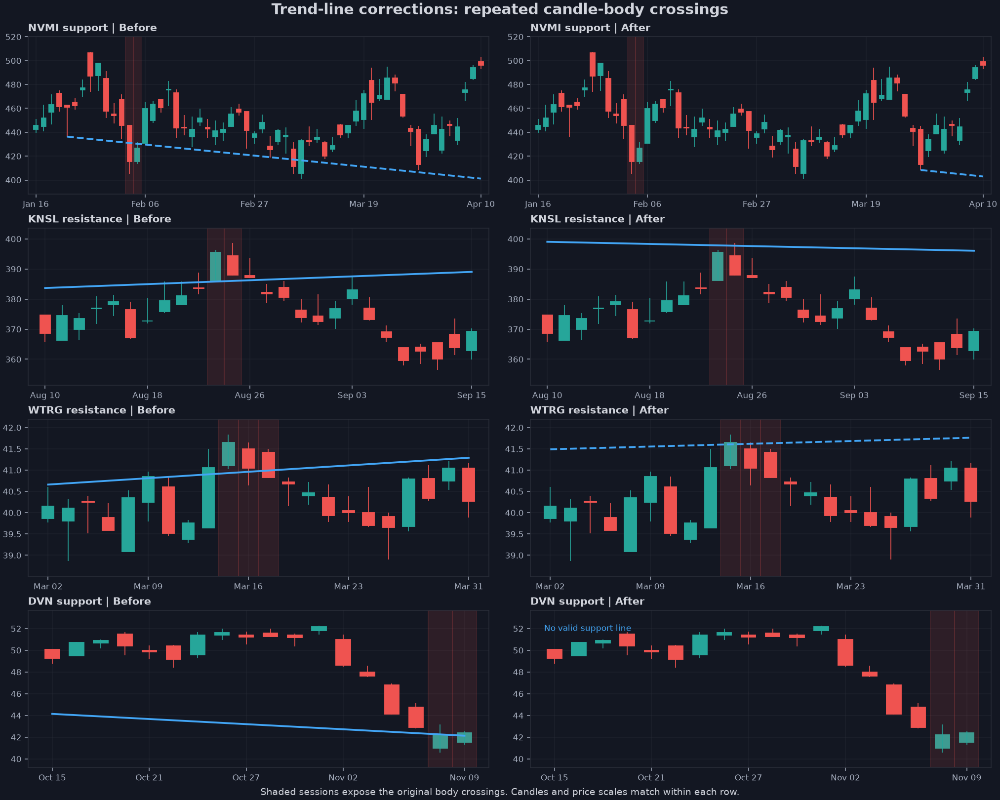

# Trend-line audit — 2026-11-10

Reviewed **224 chart images for 224 distinct symbols** from
`/home/engine-33ai/Downloads/charts`: all 35 latest-trade images and 189
signal-log images, taking the first occurrence of each additional symbol in
the export report. The complete export contains 996 images for 371 symbols.
The [review manifest](reviewed-charts.csv) records every reviewed filename,
its SHA-256 hash, and the resulting detector changes.

The blue support/resistance lines are mostly plausible, but some cross
successive candle bodies. These are separate from the yellow saved pattern
annotations. Several errors visible in the exports (including the old MORN,
JKHY and PRIM regimes) already have fixes in the starting code. This audit
found another remaining failure in the current detector.

The detector checked closes, a maximum single-body depth, and overall
penetration percentages. It could therefore join anchors across two or more
successive bodies beyond the line when the closes recovered. A long history
diluted the crossings below the percentage limit. The same omission allowed
extensions through repeated recovered openings.

The shared detector now treats two consecutive bodies beyond the existing
touch tolerance as a regime break. It rejects anchored spans and extensions
that bridge the break, then selects another valid fit or omits that side.
It also marks a clipped historical line broken when a body break happens
after its last anchor, even if the latest close recovers. PNG rendering and
interactive charts both consume this detector and retain the dashed broken
style. Isolated wick spikes and isolated shallow body crossings remain
permitted under the existing noise tolerances; this change does not claim
that every price excursion must lie inside a line.

For quantitative verification, downloaded each sampled symbol's candles
from the project's existing stocks-history API, normalized them with the
chart renderer, and fitted the final 252 valid daily candles through
2026-11-09. The starting detector produced 426 lines. **23 lines across 22
symbols contained consecutive body cuts**. The correction refits or clips
17 of them and removes 6 without valid replacements. The resulting 420
drawn lines have zero consecutive body cuts. Five lines also change to the
broken state, including one whose geometry changed. These counts describe
recomputed lines on the sampled tapes, rather than an accuracy percentage
for the original image collection.

| Example | Crossed sessions | Result |
| --- | --- | --- |
| NVMI support | Feb 4–5 | Replace the Jan 23 origin with Mar 30; retain the Oct 23 endpoint. |
| KNSL resistance | Aug 24–25 | Select the clean Jan 8–Oct 22 boundary instead of the Apr 9 origin. |
| WTRG resistance | Mar 13, 16–17 | Replace the Dec 18–Nov 9 projection with a Nov 14–Oct 23 anchored span, marked broken. |
| DVN support | Nov 6 and 9 | Omit support until another valid fit is available. |

Dates in the table are in 2026 except the November/December origins, which
are in 2025. Adjacent sessions can span a weekend or holiday.



The comparison zooms into the affected sessions. Line styles describe the
full window through Nov 9, including breaks after the zoomed region.

Validation: **264 Python tests passed**, covering the detector, PNG/viewer
geometry, paper books and replay integration. Added 24 cases covering
recovered body crossings on either side, anchor/extension handling,
refitting, broken styling and four frozen real-symbol tapes in
`tests/fixtures/trendline_body_clusters.json`. The existing isolated-spike,
price-scale and previous regime regressions still pass. All four JavaScript
checks passed for bundled-library geometry, exports, drawing and replay.
Fourteen new regression cases fail against the starting detector and pass
with the correction.

```sh
MPLCONFIGDIR=/tmp/trendline-audit/mpl .venv/bin/pytest \
  analysis/test_trendlines.py analysis/test_trendline_rendering.py \
  analysis/test_chart_viewer_payload.py core/test_paper_books.py \
  web/test_replay_flow.py -q
node web/test_trendline_geometry.cjs
node web/test_chart_export.cjs
node web/test_chart_draw.cjs
node web/test_replay_client.cjs
```

The paper-book integration tests require loopback socket access. Original
downloaded images were preserved; charts must be exported again to show the
updated detector.
