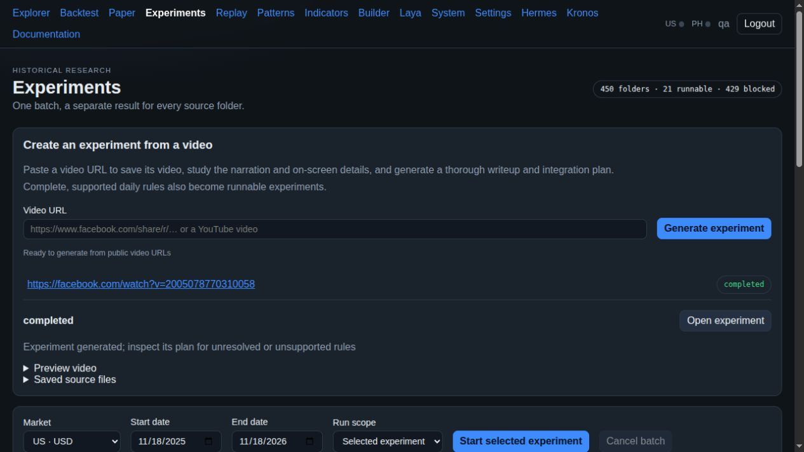

# URL experiment generation verification

Date: 2026-11-18 (Asia/Manila).

## Automated checks

```bash
.venv/bin/pytest -q core/test_experiment_imports.py core/test_experiments.py core/test_experiments_audit.py web/test_experiments_api.py web/test_settings_api.py
node web/test_experiments.cjs
.venv-experiments/bin/python scripts/experiment_media.py --check
git diff --check
```

Result: **129 Python tests passed**, frontend tests passed, the optional media
worker imported successfully, and the patch had no whitespace errors. The only
Python warning was the existing Loguru use of a deprecated asyncio helper.
FastAPI TestClient requires local socket access in this host's sandbox; the
suite passed with that access enabled.

Coverage includes URL validation and private-address rejection, durable jobs,
tracking-parameter deduplication, cancellation and retry attempt fencing,
interrupted work, extra-frame analysis, source/rule integrity and compiler
version pins, SDK credential-header isolation, causal rule values and prefix
invariance, selected-source runs, saved batch snapshots, authenticated file
access/ranges, frontend retry/progress, safe text rendering and stale responses.
Existing archived experiment/replay and Settings regressions also pass.

## Real media and model checks

A previously supplied video was used for an isolated test:
[Facebook EMA poster](https://www.facebook.com/watch/?v=2005078770310058).
The new worker downloaded its 546,193-byte, 15-second video, performed the full
FFmpeg audio/video decode, recorded its SHA-256, sampled twelve original frames
and prepared the full local transcript/caption record. A separate tail-seek
check correctly recorded the last actual decoded frame at 14.9667 seconds.

A real source-generation call through the existing DeepSeek Flash vision
credential succeeded. The complete URL-job path then saved 39 artifacts,
including a **956-word writeup** and **1,410-word integration plan**, plus a
persistent generated catalog entry. Explicit retry reused the saved verified
media/evidence. The generated interpretation correctly left replay blocked
because the source did not establish a daily-equity timeframe and omitted other
material execution details. It did not invent a complete strategy from the
poster. The runnable branch is covered by deterministic source/rule fixtures.

The configured Anthropic credential returned HTTP 401 during the earlier
provider check. The final implementation explicitly defaults to the existing
working DeepSeek vision provider and offers Anthropic as a selectable option;
it never silently switches providers after a job fails. Credentials are not
included in this report, the frontend, model input or media-worker environment.

## Browser check

The browser-use skill was used with the approved host-managed in-app browser
against an isolated local test server and temporary experiment database.
Verified URL submission and archival reuse, saved video/files, opening an
experiment, a completed selected-folder historical run, and inspection of its
source/plan. After a server/page reload, the separately generated real source
was visible in the catalog with its persisted completion and replay blocker.
The selected run contained one folder rather than the whole catalog.

The historical run used synthetic test bars. Its results are UI/lifecycle
verification, not trading-performance evidence. The real generation and test
runs used temporary storage; the production experiment database and archived
source bundle were not populated with test results. The isolated test server
was stopped after verification.


